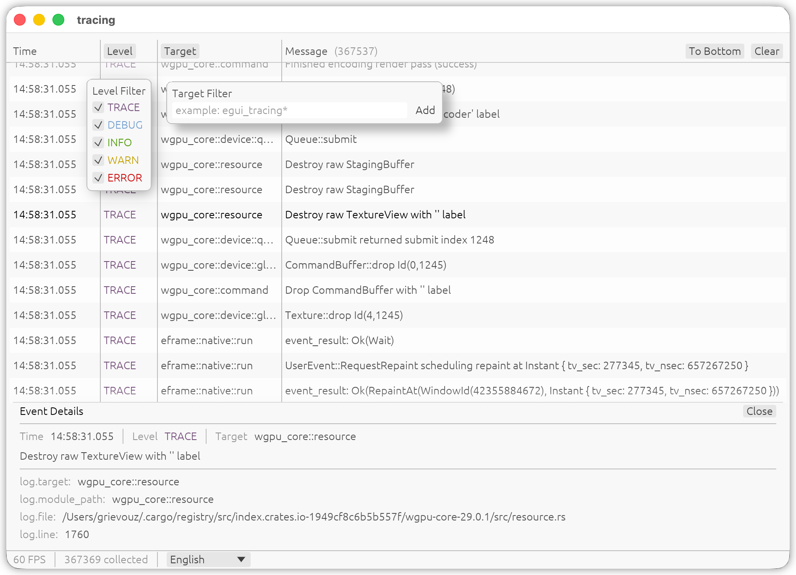

# egui_tracing

[](https://crates.io/crates/egui_tracing)
[](https://docs.rs/egui_tracing)
[](https://github.com/grievouz/egui_tracing/blob/main/LICENSE)


`egui_tracing` is a Rust library that integrates tracing and logging capabilities with the [egui](https://github.com/emilk/egui) immediate mode graphical user interface library. It supports both the [tracing](https://crates.io/crates/tracing) and [log](https://crates.io/crates/log) crates for efficient and flexible event collection and visualization.

[Click to view the web demo](https://grievouz.github.io/egui_tracing/)

## Installation

Add `egui_tracing` to your `Cargo.toml` dependencies:

```toml
[dependencies]
egui_tracing = "0.3.0"
```

## Usage

Set up the collector once at startup and register it as a `tracing` layer:

```rust
let collector = egui_tracing::EventCollector::default();
tracing_subscriber::registry().with(collector.clone()).init();
```

Then render the log view anywhere inside your egui UI:

```rust
ui.add(egui_tracing::Logs::new(collector.clone()));
```

To localize the UI, pass a `Labels` value (built-in: `english`, `portuguese`):

```rust
ui.add(
    egui_tracing::Logs::new(collector.clone())
        .with_labels(egui_tracing::Labels::portuguese()),
);
```

## Timestamp backends

Existing `EventCollector`, `tracing::CollectedEvent`, and `Logs` names remain
concrete chrono aliases. Their timestamp field is still
`chrono::DateTime<chrono::Local>`; existing constructors and struct literals do
not need type annotations or changes.

The optional `time` feature adds UTC timestamps:

```toml
[dependencies]
egui_tracing = { version = "0.3.0", features = ["time"] }
```

```rust
let collector = egui_tracing::TimeEventCollector::new();
// Register collector.clone() as a tracing layer, then render:
ui.add(egui_tracing::TimeLogs::new(collector.clone()));
```

`TimeEventCollector` is shorthand for
`GenericEventCollector::<time::OffsetDateTime>`. Likewise, `TimeLogs` and
`tracing::TimeCollectedEvent` are aliases of `GenericLogs<T>` and
`tracing::GenericCollectedEvent<T>`. Both backends can collect the same tracing
event independently. Enabling a feature never switches an existing field's type;
`--all-features` is supported.

Implement the small `Timestamp` trait on a local newtype to use a custom clock:
`now`, `format_short`, and `format_detailed`. The generic collector, event, and
widget carry that type end to end using static dispatch. No runtime selector or
configuration object is required. Timestamp implementations must be cloneable,
thread-safe and support capture on the emitting thread.

### Compatibility and timezone behavior

- Chrono retains local-time capture and its existing display formats.
- The time backend captures UTC, labels table timestamps with `Z`, and includes
  the numeric offset in details. It does not attempt local-offset discovery or
  silently fall back from local time; this avoids native multithreaded offset
  lookup failures and daylight-saving ambiguity. Detailed timestamps retain
  subsecond precision; table timestamps display milliseconds. Custom timestamp
  newtypes can implement other clock/timezone policies.
- Both backends enable their JavaScript clock support automatically on wasm32;
  the existing `wasmbind` feature remains supported for chrono compatibility.
- Chrono intentionally remains an unconditional dependency in this additive
  prototype: it was already available with `default-features = false`. The time
  feature therefore **does not remove the chrono audit notice**, even if only
  the time collector is used. Making chrono optional would require a separate
  compatibility decision for existing no-default-feature consumers.
- time 0.3.55 declares Rust 1.88. The current egui 0.36 dependency graph already
  declares Rust 1.95; this addition does not increase that graph's declared floor.
  These are dependency metadata requirements, not a tested crate-wide MSRV promise.

## Example



To run the example application, use the following command:

```sh
cargo run --bin example-eframe
```

## Contributing

Contributions to `egui_tracing` are welcome! Please open an issue or submit a pull request on the GitHub repository.

## License

`egui_tracing` is released under the [Unlicense](LICENSE.md). This means the code is in the public domain, and you can use, modify, and distribute it without any restrictions. For more information, please see the [Unlicense website](https://unlicense.org/).
